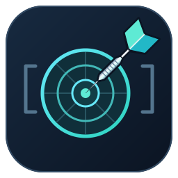

<p align="center">
  
</p>

<h1 align="center">OcheCore</h1>

<p align="center">
  <b>Offline dartboard control, built in Rust.</b><br>
  One daemon. A command line and an interactive terminal UI.<br>
  Your board, managed locally or across your LAN.
</p>

<p align="center">
  <a href="https://github.com/mondeggo/ochecore/actions/workflows/ci.yml"></a>
  <a href="https://github.com/mondeggo/ochecore/actions/workflows/docker.yml"></a>
  <a href="https://github.com/mondeggo/ochecore/releases/latest"></a>
</p>

<p align="center">
  
  
  
  <a href="LICENSE"></a>
  
</p>

<p align="center">
  <a href="#run-from-source">Get started</a> ·
  <a href="#terminal-ui">Terminal UI</a> ·
  <a href="#docker">Docker</a> ·
  <a href="docs/native-api.md">Native API</a> ·
  <a href="oche-core-roadmap.md">Roadmap</a>
</p>

<br>

Offline Rust board control service, command-line tools, and an interactive terminal
UI. The control foundation works without cameras or recordings. Camera capture,
calibration, vision, and verified Autodarts compatibility will be added later.

**Available now:** foreground daemon, local/LAN management, persistent board ID
and configuration, start/stop/reset/wake, logical standby, bounded native events,
editable camera-slot settings, diagnostics, and explicit synthetic demo mode.
There is no live scoring yet. Camera settings are requested values only.

## Run from source

Install Rust with [rustup](https://rustup.rs/). This repository pins Rust 1.90.0,
rustfmt, and Clippy. Development builds need a Linux C linker (for example,
`build-essential` on Debian/Ubuntu). No OpenCV or camera SDK is needed yet.

```sh
cargo build --locked --release -p oche-cli
./target/release/oche-core run
```

In another terminal, run `./target/release/oche-core remote`. Running without a
subcommand also opens the TUI. Closing the UI leaves the daemon running. If the
daemon is missing, the UI explains how to start it and reconnects automatically.

First run creates `$XDG_CONFIG_HOME/ochecore/board.toml`, or
`~/.config/ochecore/board.toml`. Use `--config FILE` for a separate board. Board ID
survives rename/restart; session ID changes on restart. A file lock prevents two
daemons from owning one configuration.

## Commands

```sh
oche-core status --json
oche-core start
oche-core stop
oche-core reset
oche-core wake
oche-core events --json
oche-core events --json --count 5
oche-core doctor
oche-core config init                 # optional; never overwrites existing config
oche-core config validate             # local TOML validation
oche-core config export               # connected daemon's configuration
oche-core config set board.name "Basement board"
oche-core config set detection.speed low
oche-core config set detection.standby_seconds 1800
oche-core config set cameras.count 3
oche-core config set cameras.1.device /dev/v4l/by-path/REPLACE_WITH_DEVICE
oche-core config set cameras.1.width 1280
oche-core config set cameras.1.height 720
oche-core config set cameras.1.fps 30
oche-core config set cameras.1.rotation 90
oche-core cameras list --json
oche-core cameras inspect --camera 1
```

`config set` validates and atomically saves through the daemon; board ID is read
only. `init` and `validate` are local file operations. Camera count is 1–4;
decreasing it removes the highest slots. Assigned device paths must be unique.
Supported hardware modes are not enumerated or verified until capture exists.

Speed presets: `very_low`, `low`, `default`, `high`, `very_high`. They are saved for
the future detector and currently have no capture effect. Standby values:
`0` (disabled), `300`, `600`, `900`, `1800`, or `3600` seconds. Polling does not keep
the service awake. Start/wake changes the control lifecycle; capture is unavailable.
`calibrate --camera 1` and `calibrate --all` explicitly report not implemented.

JSON goes to stdout; errors/diagnostics go to stderr. Exit codes: `0` success,
`1` operational error, `2` command-line usage error. Ctrl-C/SIGTERM stops the daemon.

## Terminal UI

Screens: **Overview**, **Cameras**, **Configuration**, **Events**, **Help**.
Works over SSH without terminal image support.

| Key | Action |
| --- | --- |
| Tab / Shift-Tab, or 1–5 | Switch screen |
| s / x / r / w | Start / stop / reset visit / wake |
| Up / Down | Select camera or setting |
| Left / Right | Select camera field or cycle editor choices |
| Enter / Escape | Edit or save / cancel |
| Ctrl-U | Clear text while editing |
| t / o | Synthetic T20 / full takeout, demo mode only |
| q / Ctrl-C | Close UI |

Edits check the state revision to detect concurrent changes. Keyboard input stays
responsive during network failures. Stale data is labeled disconnected and
controls are disabled until connectivity returns.

## Try a visit without cameras

Start `oche-core run --demo`, then use the UI or another terminal:

```sh
oche-core start
oche-core demo throw T20
oche-core demo throw D20
oche-core demo throw SB
oche-core demo takeout --remaining 1
oche-core demo takeout
```

Labels: `S1`–`S20`, `D1`–`D20`, `T1`–`T20`, `SB`, `DB`, `MISS`. Every throw is
marked synthetic. A fourth dart is rejected; early and partial takeout work.
Reset clears the logical visit while preserving simulated physical occupancy.
Only configuration/identity persist across restart; visit state is in memory.

## LAN management

```sh
oche-core --bind 0.0.0.0 --port 3180 run
oche-core --host board-host --port 3180 remote
oche-core --host board-host --port 3180 status --json
```

Default binding is loopback. `--bind` selects the listen address; `--host` selects
the daemon to manage. Listen overrides are per invocation. Saved `server.bind`
and `server.port` changes require restart; until then use the old port explicitly.

The native API is plain HTTP without authentication: anyone who can reach it can
control the board. Use loopback, a trusted/private LAN, or an SSH tunnel. No hosted
service is needed. The [native API](docs/native-api.md) is separate from future
Autodarts adapters.

## Docker

```sh
docker compose up --build -d
docker compose exec ochecore oche-core remote
docker compose exec ochecore oche-core status --json
docker compose down
```

Compose persists configuration in `board-data` and publishes port 3180 on loopback.
Set `OCHECORE_PORT=3181` to coexist with a service already using that port. Set
`OCHECORE_BIND=0.0.0.0` explicitly for trusted LAN access.

Published releases provide an AMD64/ARM64 image. Replace OWNER, REPOSITORY, and
the version with the GitHub repository and release tag:

```sh
OCHECORE_IMAGE=ghcr.io/OWNER/REPOSITORY:vX.Y.Z docker compose up -d --no-build
```

The final image contains a static executable and notices, runs as UID/GID 65532,
and needs no shell, compiler, Internet, or camera permissions. `/data` must be
writable; the rest of the filesystem can be read only. `docker compose down -v`
deletes saved board identity/settings. Camera mappings will accompany capture.

## Development and releases

```sh
cargo fmt --all -- --check
cargo clippy --workspace --all-targets --locked -- -D warnings
cargo test --workspace --locked
cargo build --locked -p oche-cli
python3 scripts/smoke.py --binary target/debug/oche-core
```

The smoke test exercises CLI/TUI editing, terminal restoration, events,
persistence, port conflicts, and shutdown with connected clients. It needs Linux,
Python 3, and permission to bind loopback sockets.

GitHub Actions checks pushes/PRs. A `vX.Y.Z` tag matching Cargo.toml builds and tests
static Linux AMD64/ARM64 binaries, creates archives/checksums, and publishes a
GitHub Release and matching Docker image. See [release setup](docs/releases.md),
including optional Docker Hub publishing with Oche's credentials convention.

Crates: `oche-domain`, `oche-engine`, `oche-api`, `oche-cli`. Capture/calibration/
vision crates will be introduced when implemented. See the
[roadmap](oche-core-roadmap.md), [deferred discovery](docs/discovery.md),
[engineering decisions](docs/architecture.md), and [AGENTS.md](AGENTS.md).
Use Conventional Commits, such as `feat(cli): add board controls`.

## License

OcheCore is licensed under the [GNU Affero General Public License version 3](LICENSE)
(`AGPL-3.0-only`). Personal, educational, and commercial use are permitted under
its terms. See [NOTICE](NOTICE). Dependencies retain their own licenses.
